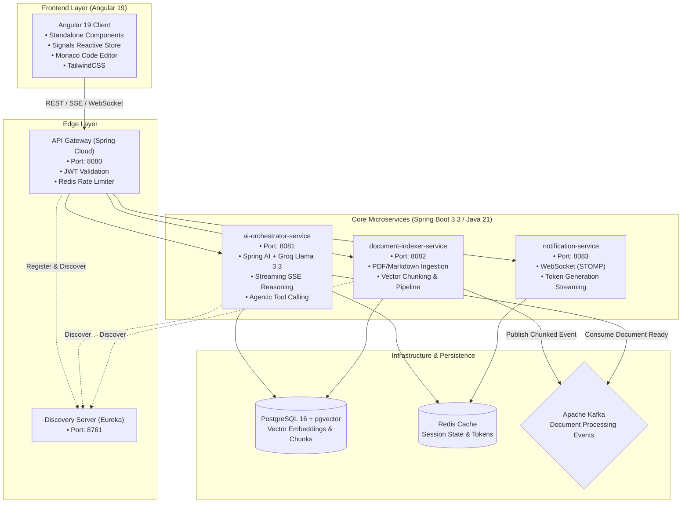

# 🧠 Synapse Enterprise AI Platform

> **Next-Generation Enterprise AI Knowledge Hub & Multi-Agent Copilot Platform** built with **Angular 19** and a **Spring Boot 3.3 Microservices Hexagonal Architecture**.

---

## 🏛️ System Architecture



---

## 📐 Hexagonal Architecture (Ports & Adapters)

Each microservice adheres strictly to **Clean / Hexagonal Architecture** with Domain-Driven Design (DDD):

```
services/<service-name>/
├── pom.xml
└── src/
    └── main/
        ├── java/com/synapse/<service>/
        │   ├── domain/                         # Enterprise Domain Rules (Zero Framework Dependencies)
        │   │   ├── model/                      # Entities, Value Objects, Domain Events
        │   │   ├── exception/                  # Domain Exceptions
        │   │   └── port/
        │   │       ├── in/                     # Inbound Ports (Use Cases / Input Interfaces)
        │   │       └── out/                    # Outbound Ports (Repository & AI SPI Interfaces)
        │   ├── application/                    # Application Use Cases
        │   │   └── service/                    # Orchestrates domain models and outbound ports
        │   └── adapter/                        # Infrastructure & Delivery Adapters
        │       ├── in/
        │       │   ├── web/                    # REST Controllers, SSE Streaming Endpoints
        │       │   └── messaging/              # Kafka Consumers & STOMP Handlers
        │       └── out/
        │           ├── persistence/            # Spring Data JPA / pgvector Repositories
        │           ├── ai/                     # Spring AI & Groq Client Adapters
        │           └── event/                  # Kafka Event Producers
        └── resources/
            ├── application.yml
            └── db/migration/                   # Flyway/Liquibase schema migrations
```

---

## 📦 Microservices Catalog

| Service | Port | Responsibilities | Primary Tech |
|---|---|---|---|
| `discovery-server` | `8761` | Microservice registry, dynamic service lookup | Spring Cloud Netflix Eureka |
| `api-gateway` | `8080` | Route routing, JWT verification, rate limiting | Spring Cloud Gateway, Redis |
| `ai-orchestrator-service` | `8081` | Multi-agent reasoning, RAG query planning, Groq tool-calling | Spring AI, Groq Llama 3.3, SSE |
| `document-indexer-service` | `8082` | Chunking, embeddings calculation, hybrid search | Apache Tika, pgvector, Kafka |
| `notification-service` | `8083` | Real-time WebSocket token streaming to Angular client | Spring WebSocket, STOMP |

---

## 🅰️ Frontend Architecture (Angular 19)

```
frontend/
├── src/
│   ├── app/
│   │   ├── core/           # Singletons, auth interceptors, global signal stores
│   │   │   ├── auth/
│   │   │   ├── interceptors/
│   │   │   └── signals/    # Reactive Angular 19 state stores
│   │   ├── features/       # Feature modules (Knowledge base, Copilot chat, Analytics)
│   │   │   ├── copilot/    # Streaming markdown chat with AI reasoning tokens
│   │   │   └── knowledge/  # Document drag-and-drop & vector status inspector
│   │   └── shared/         # Reusable UI components (Monaco editor, status badges)
│   ├── styles.scss         # TailwindCSS styles
│   └── main.ts             # Standalone bootstrap
├── angular.json
└── package.json
```

---

## 🚀 Getting Started

```bash
# Clone the repository
git clone git@github.com:MohamedAliAyedi/synapse-enterprise-ai.git
cd synapse-enterprise-ai

# Start infrastructure (PostgreSQL pgvector, Redis, Kafka)
docker-compose up -d

# Build backend microservices
mvn clean install

# Run Frontend
cd frontend
npm install
npm start
```
